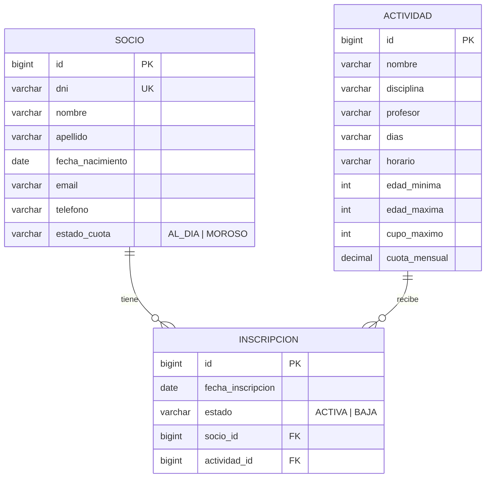

# Informe técnico: SocioClub

> BORRADOR. Faltan los marcadores `[CAPTURA: ...]` y `[COMPLETAR: ...]`. Antes de exportar a PDF (`TPI_SocioClub_GrupoN.pdf`), la primera página debe llevar el enlace al repositorio.

Taller de Construcción de Software, Universidad Siglo 21. Trabajo Práctico Integrador.

- Grupo N.º: [COMPLETAR: número de grupo]
- Integrantes: [COMPLETAR: nombres y apellidos de los integrantes]
- Repositorio: [COMPLETAR: enlace al repositorio de GitHub]

## 1. Descripción de la solución

SocioClub es un sistema web de gestión de socios, actividades e inscripciones para el Club Social y Deportivo Los Algarrobos (Córdoba). Se compone de tres "caras" que comparten una sola base de datos MySQL y un solo backend Spring Boot:

| Parte | Carpeta | Descripción |
|---|---|---|
| A. Sitio público | `/sitio-publico` | HTML5, CSS3 y JavaScript. Es un sitio estático: el catálogo de actividades sale de un arreglo de objetos en JavaScript y el formulario de preinscripción se valida solo en el cliente. No se conecta al backend. |
| B. Backoffice | `/backend` | Spring Boot + Thymeleaf + Spring Data JPA + MySQL. Vistas para la secretaría: actividades, socios (paginado) e inscripciones. |
| C. API REST | `/backend` | Controladores `@RestController` que reutilizan la misma capa de servicio que el backoffice. Incluye CORS para `http://localhost:3000`. |
| D y E. App de socios | `/app-socios` | App React "Mi Club" (create-react-app, Axios, React Router, PropTypes, Context). El socio ingresa con su DNI, ve actividades, se inscribe y se da de baja. |

Reglas de negocio de inscripción, aplicadas en la capa de servicio:

| Regla | Descripción | Mensaje (HTTP 409) |
|---|---|---|
| RN1 | La actividad debe tener cupo disponible. | La actividad no tiene cupo disponible |
| RN2 | El socio no puede estar ya inscripto en la actividad. | El socio ya está inscripto en esta actividad |
| RN3 | La edad del socio debe estar dentro del rango de la actividad. | La edad del socio no está dentro del rango permitido (X a Y años) |
| RN4 | El socio no puede estar moroso. | Debe regularizar su cuota en secretaría |
| RN5 | Un socio puede tener como máximo 3 actividades. | Alcanzó el máximo de 3 actividades |

El orden de evaluación en `InscripcionService.inscribir` es RN4, RN2, RN5, RN3 y RN1. La baja es lógica: la inscripción pasa a estado `BAJA` y deja de contar para el cupo y para el máximo de 3.

## 2. Arquitectura

```
[ Navegador del vecino ]   [ Navegador de Marta ]   [ Celular del socio ]
  Sitio público (A)          Vistas Thymeleaf (B)     App React "Mi Club" (D)
                                     |                       | Axios (JSON)
                                     v                       v
                +-----------------------------------------------------+
                |        BACKEND SPRING BOOT (un solo proyecto)       |
                |  Controladores MVC (B)      Controladores REST (C)  |
                |  Capa de SERVICIO      (reglas RN1 a RN5)           |
                |  Capa de REPOSITORIO   (Spring Data JPA)            |
                |  Capa de MODELO        (entidades JPA)              |
                +--------------------------+--------------------------+
                                           v
                                  [ Base de datos MySQL ]
```

Los controladores MVC y los REST usan la misma capa de servicio: una inscripción se valida igual venga de la secretaría o de la app del socio.

Paquetes del backend (`ar.edu.siglo21.socioclub`): `model` (entidades y enums), `repository` (Spring Data JPA), `service` (reglas de negocio), `controller` (MVC), `api` (REST y manejo de errores HTTP), `dto` (objetos devueltos por JSON), `exception` (`ReglaNegocioException` para 409 y `RecursoNoEncontradoException` para 404) y `config` (`Clock` y CORS).

Decisiones relevantes:

- **Ciclo JSON Socio ↔ Inscripcion**: `Socio` tiene una lista de `Inscripcion` y cada `Inscripcion` apunta a su `Socio`; serializar la entidad produciría un bucle infinito. La API devuelve DTOs planos (`InscripcionDto`, `SocioDto`, `ActividadDto`).
- **Relaciones LAZY y `open-in-view=false`**: las consultas que necesitan el socio o la actividad los traen con `join fetch` o `@EntityGraph`.
- **Fecha actual inyectable**: la edad se calcula con `Period.between(nacimiento, hoy)` y "hoy" viene de un bean `Clock`, lo que permite fijar la fecha en las pruebas.
- **Concurrencia**: el control de cupo cuenta y luego inserta; dos pedidos simultáneos por el último lugar podrían pasar ambos. Se acepta para este trabajo; en producción habría que bloquear la actividad o usar una restricción en la base.

## 3. Modelo de datos

Tablas del script `database/socioclub.sql` (MySQL 8). La aplicación también crea las tablas por sí misma (`spring.jpa.hibernate.ddl-auto=create`) y carga `data.sql` en cada arranque.



Mapeo JPA: `Socio` tiene `@OneToMany(mappedBy = "socio")` hacia `Inscripcion`; `Inscripcion` tiene dos `@ManyToOne(fetch = LAZY, optional = false)`, uno hacia `Socio` y otro hacia `Actividad`. Los estados (`EstadoCuota`, `EstadoInscripcion`) se persisten como texto (`@Enumerated(EnumType.STRING)`).

Datos iniciales: 8 actividades y 24 socios de prueba (dos morosos). Yoga se cargó llena (15 de 15) para poder demostrar RN1.

## 4. API REST

Base: `http://localhost:8080` por defecto (en las pruebas de sistema se usó el puerto 8081).

| Verbo | Ruta | Descripción | Respuestas |
|---|---|---|---|
| GET | `/api/actividades` (`?disciplina=Fútbol`) | Lista las actividades con su cupo disponible | 200 |
| GET | `/api/actividades/{id}` | Detalle de una actividad | 200 / 404 |
| POST | `/api/actividades` | Crea una actividad | 201 / 400 |
| PUT | `/api/actividades/{id}` | Modifica una actividad | 200 / 400 / 404 |
| DELETE | `/api/actividades/{id}` | Elimina una actividad sin inscriptos activos | 204 / 404 / 409 |
| GET | `/api/socios/dni/{dni}` | Busca un socio por DNI (ingreso a la app) | 200 / 404 |
| GET | `/api/socios/{id}/inscripciones` | Inscripciones activas de un socio | 200 / 404 |
| POST | `/api/inscripciones` | Inscribe un socio (`{"socioId":3,"actividadId":1}`); aplica RN1 a RN5 | 201 / 400 / 404 / 409 |
| PUT | `/api/inscripciones/{id}/baja` | Baja lógica de una inscripción | 200 / 404 |

Respuesta de una regla que rechaza la operación (409):

```json
{ "error": "La actividad no tiene cupo disponible", "regla": "RN1" }
```

Colección Postman: `backend/postman/SocioClub.postman_collection.json`, con casos exitosos y de error para cada endpoint.

## 5. App React "Mi Club"

- Rutas: `/` (ingreso por DNI), `/actividades`, `/actividades/:id` y `/mis-actividades`.
- Estado compartido del socio mediante `createContext` / `useContext` (`ContextoSocio`).
- Todas las llamadas a la API pasan por un único módulo, `src/servicios/api.js`, con Axios; la URL base se toma de una variable de entorno.
- Componentes principales: `Encabezado`, `Pie`, `ListaActividades`, `TarjetaActividad` (muestra "Sin cupo" y deshabilita el botón cuando el cupo es 0), `DetalleActividad`, `MisActividades` y `ResumenCuota`, con PropTypes.
- Los mensajes de error 409 de la API se muestran en pantalla.
- Utilidades con pruebas: `calcularCuotaMensual` (cuota estimada) y `esDniValido`.

## 6. Resultados de pruebas

El detalle (seis casos de sistema con resultados reales y pruebas automatizadas) está en [pruebas-de-sistema.md](pruebas-de-sistema.md).

Resumen:

| Alcance | Resultado |
|---|---|
| Backend (`mvn test`) | 72 pruebas en verde |
| Colección Postman | 26/26 correctas |
| Sitio público (Jest) | 99 pruebas en verde |
| App React (Jest + RTL) | 19 pruebas en verde |
| Sistema: inscripción exitosa y baja, RN1 a RN5 | 6 de 6 casos con el resultado esperado |

## 7. Capturas de pantalla

- Sitio público: [CAPTURA: página de actividades del sitio público]
- Backoffice Thymeleaf: [CAPTURA: listado de actividades o de socios del backoffice]
- App React: [CAPTURA: pantalla "Mis actividades" o detalle de una actividad en la app]

## 8. Conclusiones

[COMPLETAR: conclusiones del grupo. Puntos que el borrador sugiere desarrollar, a confirmar con la experiencia real del equipo:]

- Qué aportó compartir una única capa de servicio entre el backoffice y la API.
- Cómo se resolvió el ciclo JSON entre `Socio` e `Inscripcion`.
- Limitaciones conocidas: concurrencia en el control de cupo y sitio público sin conexión al backend por diseño.
- Qué haría distinto el grupo y qué dificultades encontró.

## 9. Bitácora de uso de inteligencia artificial

Ver [bitacora-ia.md](bitacora-ia.md).
