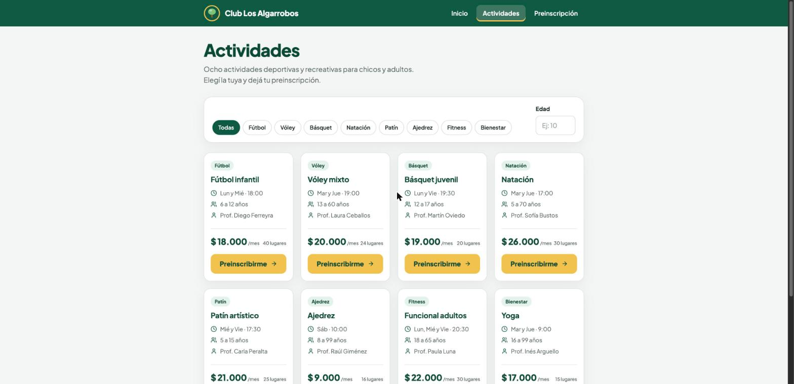
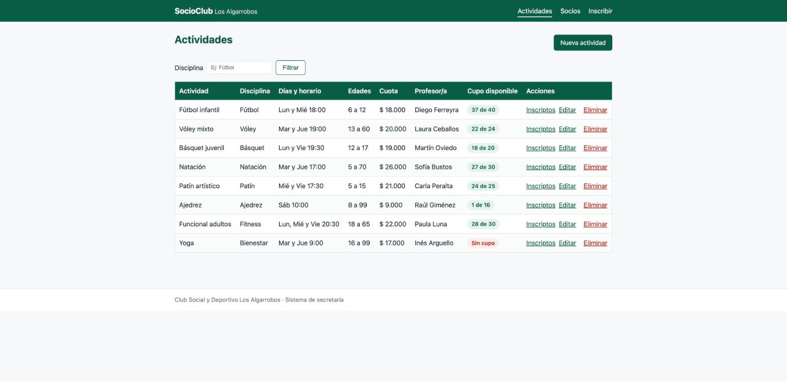
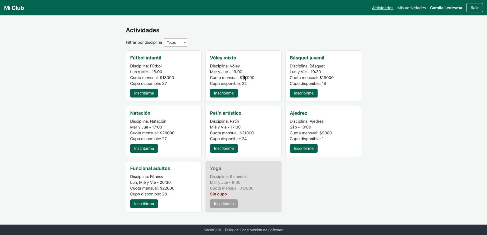

# Informe técnico: SocioClub

> BORRADOR. Quedan marcadores `[COMPLETAR: ...]` (grupo, integrantes, enlace al repositorio y conclusiones propias del equipo). Antes de entregar el PDF (`TPI_SocioClub_GrupoN.pdf`), la primera página debe llevar el enlace al repositorio.

Taller de Construcción de Software, Universidad Siglo 21. Trabajo Práctico Integrador.

- Grupo N.º: [COMPLETAR: número de grupo]
- Integrantes: [COMPLETAR: nombres y apellidos de los integrantes]
- Repositorio: [COMPLETAR: enlace al repositorio de GitHub]

## 1. Descripción de la solución

SocioClub es un sistema web de gestión de socios, actividades e inscripciones para el Club Social y Deportivo Los Algarrobos (Córdoba). Se compone de tres "caras" que comparten una sola base de datos MySQL y un solo backend Spring Boot:

| Parte | Carpeta | Descripción |
|---|---|---|
| A. Sitio público | `/sitio-publico` | HTML5, CSS3 y JavaScript. Es un sitio estático: el catálogo de actividades sale de un arreglo de objetos en JavaScript y el formulario de preinscripción se valida solo en el cliente. No se conecta al backend. |
| B. Backoffice | `/backend` | Spring Boot + Thymeleaf + Spring Data JPA + MySQL. Vistas para la secretaría: actividades, socios (paginado) e inscripciones. |
| C. API REST | `/backend` | Controladores `@RestController` que reutilizan la misma capa de servicio que el backoffice. Incluye CORS para `http://localhost:3000`. |
| D y E. App de socios | `/app-socios` | App React "Mi Club" (create-react-app, Axios, React Router, PropTypes, Context). El socio ingresa con su DNI, ve actividades, se inscribe y se da de baja. |

Los usuarios son tres: el vecino que mira el club desde afuera (sitio público), la secretaria que administra datos (backoffice Thymeleaf) y el socio que gestiona sus propias actividades desde el celular (app React).

### 1.1 Reglas de negocio de inscripción

Se aplican en la capa de servicio, y la API responde HTTP 409 cuando alguna rechaza la operación:

| Regla | Descripción | Mensaje (HTTP 409) |
|---|---|---|
| RN1 | La actividad debe tener cupo disponible. | La actividad no tiene cupo disponible |
| RN2 | El socio no puede estar ya inscripto en la actividad. | El socio ya está inscripto en esta actividad |
| RN3 | La edad del socio debe estar dentro del rango de la actividad. | La edad del socio no está dentro del rango permitido (X a Y años) |
| RN4 | El socio no puede estar moroso. | Debe regularizar su cuota en secretaría |
| RN5 | Un socio puede tener como máximo 3 actividades. | Alcanzó el máximo de 3 actividades |

El orden de evaluación en `InscripcionService.inscribir` es RN4, RN2, RN5, RN3 y RN1: primero las reglas baratas que dependen solo del socio, y al final la que cuenta las inscripciones de la actividad. La baja es lógica: la inscripción pasa a estado `BAJA` y deja de contar para el cupo y para el máximo de 3.

Además hay dos reglas del lado cliente: RN6 (cuota mensual estimada: suma de las cuotas con 10 % de descuento por 2 actividades y 15 % por 3, función `calcularCuotaMensual` de la app) y RN7 (un DNI válido tiene 7 u 8 dígitos, sin puntos ni letras, validado tanto en el sitio público como en la pantalla de ingreso de la app).

## 2. Arquitectura

```
[ Navegador del vecino ]   [ Navegador de la secretaría ]   [ Celular del socio ]
  Sitio público (A)           Vistas Thymeleaf (B)            App React "Mi Club" (D)
  (estático, sin backend)              |                              | Axios (JSON)
                                       v                              v
                +-----------------------------------------------------------+
                |           BACKEND SPRING BOOT (un solo proyecto)          |
                |  Controladores MVC (B)          Controladores REST (C)    |
                |  Capa de SERVICIO        (reglas RN1 a RN5)               |
                |  Capa de REPOSITORIO     (Spring Data JPA)                |
                |  Capa de MODELO          (entidades JPA)                  |
                +----------------------------+------------------------------+
                                             v
                                    [ Base de datos MySQL ]
```

### 2.1 Capas y por qué las reglas viven en el servicio

Paquetes del backend (`ar.edu.siglo21.socioclub`):

| Paquete | Responsabilidad |
|---|---|
| `model` | Entidades JPA `Socio`, `Actividad`, `Inscripcion` y los enums `EstadoCuota` y `EstadoInscripcion`. |
| `repository` | Interfaces Spring Data JPA: consultas derivadas (`findByDni`, `findByDisciplinaIgnoreCase`) y `@Query` para los conteos de cupo. |
| `service` | Reglas de negocio y transacciones (`InscripcionService`, `ActividadService`, `SocioService`). |
| `controller` | Controladores MVC de Thymeleaf. Solo llaman a servicios. |
| `api` | Controladores REST y `ApiExceptionHandler`, que traduce excepciones a códigos HTTP. |
| `dto` | Registros planos devueltos por JSON (`InscripcionDto`, `SocioDto`, `ActividadDto`) y registros de entrada validados (`InscripcionRequest`, `ActividadRequest`). |
| `exception` | `ReglaNegocioException` (409, con el código de regla) y `RecursoNoEncontradoException` (404). |
| `config` | Bean `Clock` y configuración de CORS. |

Las cinco reglas están en `InscripcionService` y no en los controladores por una razón concreta: el backoffice (Thymeleaf) y la API (REST) son dos puertas de entrada al mismo caso de uso. Si las reglas estuvieran en un controlador, habría que duplicarlas en el otro y tarde o temprano divergirían. Con un único servicio, una inscripción se valida igual venga de la secretaría o de la app del socio. Cada controlador solo adapta el formato: el MVC pone el mensaje de la excepción en la vista y el REST lo convierte en una respuesta 409 con cuerpo JSON. Una segunda ventaja es la testabilidad: el servicio se prueba con Mockito sin levantar Spring ni la base.

### 2.2 Recorrido de una inscripción

Esto es lo que pasa cuando el socio toca "Inscribirme" en la pantalla de detalle de una actividad:

1. **Interfaz.** `DetalleActividad` ejecuta `manejarInscripcion`: marca `enviando`, borra el error y el éxito anteriores y llama a `inscribirSocio(socio.id, actividad.id)`.
2. **Axios.** `servicios/api.js` envía `POST /api/inscripciones` con `{"socioId": ..., "actividadId": ...}`. Todas las llamadas HTTP de la app pasan por ese único módulo.
3. **Controlador REST.** `InscripcionRestController.inscribir` recibe el cuerpo, lo valida con `@Valid` (`InscripcionRequest`) y delega en el servicio.
4. **Servicio.** `InscripcionService.inscribir` (método `@Transactional`) carga el socio y la actividad (404 si no existen) y evalúa RN4, RN2, RN5, RN3 y RN1. Si una falla lanza `ReglaNegocioException` y la transacción se revierte.
5. **Repositorio y MySQL.** Cada regla consulta `InscripcionRepository` (existencia, conteo por socio, conteo por actividad). Si todas pasan, se arma la `Inscripcion` en estado `ACTIVA` con la fecha de hoy (tomada del `Clock`) y `save` hace el `INSERT` en la tabla `inscripcion`.
6. **Respuesta.** El controlador convierte la entidad en `InscripcionDto` y responde 201. Si hubo una regla incumplida, `ApiExceptionHandler` responde 409 con `{"error": "...", "regla": "RNx"}`.
7. **Interfaz otra vez.** Con 201, la pantalla muestra "Inscripción realizada" y vuelve a pedir la actividad para actualizar el cupo. Con 409, `obtenerMensajeError` extrae el campo `error` y lo muestra en un mensaje de alerta.

### 2.3 Decisiones y compromisos (trade-offs)

| Decisión | Motivo | Costo o límite |
|---|---|---|
| **DTOs en la API** en vez de serializar entidades | `Socio` tiene una lista de `Inscripcion` y cada `Inscripcion` apunta a su `Socio`: serializar la entidad produce un bucle infinito. Los registros planos cortan el ciclo y además fijan el contrato JSON. | Hay que mantener una conversión entidad a DTO (`from`). |
| **Relaciones LAZY y `open-in-view=false`** | Evita consultas ocultas desde la vista. Los controladores no recorren relaciones perezosas fuera del servicio. | Las consultas que necesitan el socio o la actividad los traen explícitamente con `join fetch` o `@EntityGraph`. |
| **Bean `Clock` inyectable** | La edad se calcula con `Period.between(nacimiento, hoy)` (cuenta solo años cumplidos) y "hoy" sale del `Clock`, así las pruebas fijan la fecha y los casos de borde (cumpleaños mañana) son deterministas. | Un parámetro más en el constructor del servicio. |
| **Orden RN4, RN2, RN5, RN3, RN1** | Las reglas que dependen solo del socio (o una existencia) se evalúan antes que el conteo de la actividad. También decide qué mensaje ve el usuario si fallan varias a la vez. | El orden es parte del comportamiento: cambiarlo cambia el mensaje devuelto. |
| **Contar y luego insertar** para el cupo | Es simple y alcanza para la escala del trabajo. | **No es seguro ante concurrencia**: dos pedidos simultáneos por el último lugar podrían pasar ambos. En producción habría que bloquear la actividad (bloqueo pesimista) o usar una restricción en la base. |
| **Ingreso solo en memoria** (Context, sin `localStorage`) | El enunciado pide ingresar con el DNI sin contraseña; guardar el socio solo en el estado de React evita persistir datos personales en el navegador. | **Al refrescar la página se pierde la sesión** y la ruta protegida redirige al ingreso. |
| **Jest de CRA con `react-router-dom` v7** | La app usa React Router v7, pero el Jest de create-react-app no resuelve ese módulo. | En las pruebas de componentes el router se reemplaza por un doble (stub), sin tocar el código de la app. |
| **Sitio público estático** | El enunciado define la Parte A sin conexión al backend: catálogo en JavaScript y validación solo en el cliente. | El catálogo del sitio y los datos del backend se mantienen por separado. |

## 3. Modelo de datos

Tablas del script `database/socioclub.sql` (MySQL 8). La aplicación también crea las tablas por sí misma (`spring.jpa.hibernate.ddl-auto=create`) y carga `data.sql` en cada arranque, de modo que el script manual no es necesario para correr el sistema.

```
 +-------------------+         +----------------------+         +---------------------+
 |       SOCIO       |         |     INSCRIPCION      |         |      ACTIVIDAD      |
 +-------------------+         +----------------------+         +---------------------+
 | id  PK            |1      N | id  PK               | N      1| id  PK              |
 | dni  UNIQUE       |---------| fecha_inscripcion    |---------| nombre              |
 | nombre            |         | estado (ACTIVA|BAJA) |         | disciplina          |
 | apellido          |         | socio_id  FK         |         | profesor            |
 | fecha_nacimiento  |         | actividad_id  FK     |         | dias, horario       |
 | email, telefono   |         +----------------------+         | edad_minima/maxima  |
 | estado_cuota      |                                          | cupo_maximo         |
 |  (AL_DIA|MOROSO)  |                                          | cuota_mensual       |
 +-------------------+                                          +---------------------+
```

Socio y Actividad se relacionan de muchos a muchos; la tabla `inscripcion` resuelve esa relación y además tiene atributos propios (fecha y estado), por eso es una entidad y no una simple tabla intermedia.

| Tabla | Descripción | Columnas principales |
|---|---|---|
| `socio` | Persona asociada al club. | `dni` (único, hasta 8 caracteres), nombre, apellido, `fecha_nacimiento` (base del cálculo de edad para RN3), `estado_cuota` (`AL_DIA` o `MOROSO`, base de RN4). |
| `actividad` | Disciplina ofrecida con su horario y condiciones. | `edad_minima` y `edad_maxima` (RN3), `cupo_maximo` (RN1), `cuota_mensual` (decimal 10,2), profesor, días y horario. |
| `inscripcion` | Vínculo entre un socio y una actividad. | `estado` (`ACTIVA` o `BAJA`), `fecha_inscripcion`, claves foráneas `socio_id` y `actividad_id` (ambas `NOT NULL`). |

Mapeo JPA: `Socio` tiene `@OneToMany(mappedBy = "socio")` hacia `Inscripcion`; `Inscripcion` tiene dos `@ManyToOne(fetch = LAZY, optional = false)`, uno hacia `Socio` y otro hacia `Actividad`. Los estados (`EstadoCuota`, `EstadoInscripcion`) se persisten como texto (`@Enumerated(EnumType.STRING)`), para que los datos sean legibles y no dependan del orden del enum.

Como la baja es lógica, el cupo disponible de una actividad no es una columna sino un cálculo: `cupo_maximo` menos la cantidad de inscripciones `ACTIVA` de esa actividad.

Datos iniciales: 8 actividades y 24 socios de prueba (dos morosos). Yoga se cargó llena (15 de 15) para poder demostrar RN1, y Ajedrez con 15 de 16 para mostrar el último lugar.

## 4. API REST

Base: `http://localhost:8080` por defecto (en las pruebas de sistema se usó el puerto 8081 mediante `SERVER_PORT`).

| Verbo | Ruta | Descripción | Respuestas |
|---|---|---|---|
| GET | `/api/actividades` (`?disciplina=Fútbol`) | Lista las actividades con su cupo disponible | 200 |
| GET | `/api/actividades/{id}` | Detalle de una actividad | 200 / 404 |
| POST | `/api/actividades` | Crea una actividad | 201 / 400 |
| PUT | `/api/actividades/{id}` | Modifica una actividad | 200 / 400 / 404 |
| DELETE | `/api/actividades/{id}` | Elimina una actividad sin inscriptos activos | 204 / 404 / 409 |
| GET | `/api/socios/dni/{dni}` | Busca un socio por DNI (ingreso a la app) | 200 / 404 |
| GET | `/api/socios/{id}/inscripciones` | Inscripciones activas de un socio | 200 / 404 |
| POST | `/api/inscripciones` | Inscribe un socio (`{"socioId":3,"actividadId":1}`); aplica RN1 a RN5 | 201 / 400 / 404 / 409 |
| PUT | `/api/inscripciones/{id}/baja` | Baja lógica de una inscripción | 200 / 404 |

`ApiExceptionHandler` centraliza el manejo de errores: `ReglaNegocioException` produce 409, `RecursoNoEncontradoException` produce 404, y los datos inválidos (`@Valid`) o el JSON mal formado producen 400. Respuesta de una regla que rechaza la operación (409):

```json
{ "error": "La actividad no tiene cupo disponible", "regla": "RN1" }
```

La colección Postman `backend/postman/SocioClub.postman_collection.json` incluye casos exitosos y de error para cada endpoint, con un test (`pm.test`) que verifica el estado esperado.

### 4.1 Backoffice Thymeleaf

La secretaría usa vistas renderizadas en el servidor: `/actividades` (listado, alta, edición, baja y listado de inscriptos), `/socios` (listado paginado de 10 por página, alta y edición) e `/inscripciones/nueva` (alta de inscripción, que llama al mismo `InscripcionService.inscribir`). Un `MvcExceptionHandler` muestra los errores de regla y los recursos inexistentes en pantalla.

## 5. Sitio público y app React "Mi Club"

### 5.1 Sitio público (Parte A)

Tres páginas (`index.html`, `actividades.html`, `preinscripcion.html`) con HTML semántico y una única hoja de estilos con selectores de tipo, clase, ID y atributo, y tres media queries (1024, 820 y 600 píxeles). El catálogo se genera con JavaScript a partir de una clase `Actividad` (métodos `esAptaParaEdad`, `esInfantil`, `cuotaFormateada` y `crearTarjeta`), con filtros por disciplina y edad mediante delegación de eventos. El formulario de preinscripción muestra los errores junto a cada campo, sin `alert`, y lee `location.search` para preseleccionar la actividad.

### 5.2 App React (Partes D y E)

- Rutas: `/` (ingreso por DNI), `/actividades`, `/actividades/:id` y `/mis-actividades`. Las tres últimas están envueltas en `RutaProtegida`, que redirige al ingreso si no hay socio en el contexto.
- Estado compartido del socio mediante `createContext` / `useContext` (`ContextoSocio` con `socio`, `ingresar` y `salir`), sin pasar propiedades de componente en componente.
- Todas las llamadas a la API pasan por un único módulo, `src/servicios/api.js`, con Axios; la URL base se toma de la variable de entorno `REACT_APP_API_URL` (por defecto `http://localhost:8080/api`).
- Componentes: `Encabezado`, `Pie`, `Ingreso`, `ListaActividades`, `TarjetaActividad` (muestra "Sin cupo" y deshabilita el botón cuando el cupo es 0), `DetalleActividad`, `MisActividades` y `ResumenCuota`, con PropTypes.
- Los mensajes de error 409 de la API se muestran en pantalla tal como los devuelve el backend, de modo que la app no duplica el texto de las reglas.
- Utilidades puras con pruebas: `calcularCuotaMensual` (RN6, con redondeo a centavos) y `esDniValido` (RN7).

## 6. Resultados de las pruebas

Las pruebas de sistema se ejecutaron el 11/11/2026 contra el sistema completo: MySQL 8, backend en el puerto 8081 y app React en el puerto 3000, con los datos de `database/socioclub.sql`. El detalle completo está en `docs/pruebas-de-sistema.md`.

### 6.1 Casos de sistema

| N.º | Caso | Datos | Resultado esperado | Resultado obtenido |
|---|---|---|---|---|
| 1 | Inscripción exitosa y baja | Mateo Gómez (DNI 40111001), Fútbol infantil | Éxito y cupo +1; aparece en "Mis actividades" con su cuota; tras la baja el cupo vuelve. API 201. | OK. Se mostró "Inscripción realizada"; el cupo pasó a 36/40 y la cuota estimada fue de . Tras la baja el cupo volvió a 37. |
| 2 | RN2: duplicada | Mismo socio, misma actividad | 409 (RN2) | OK. "El socio ya está inscripto en esta actividad" |
| 3 | RN1: sin cupo | Sabrina Quiroga (DNI 39333015), Yoga 15/15 | 409 (RN1) | OK. "La actividad no tiene cupo disponible" |
| 4 | RN3: edad | Tomás Acosta (DNI 40111005, 5 años), Vóley mixto | 409 (RN3) | OK. "La edad del socio no está dentro del rango permitido (13 a 60 años)" |
| 5 | RN4: moroso | Nicolás Peralta (DNI 37333008), Fútbol infantil | 409 (RN4) | OK. "Debe regularizar su cuota en secretaría" |
| 6 | RN5: máximo | Laura Fernández (DNI 28333001, 3 actividades), Vóley mixto | 409 (RN5) | OK. "Alcanzó el máximo de 3 actividades" |

En los casos 2 a 6 la app muestra en pantalla el mensaje devuelto por la API. También se verificó que el backend acepta peticiones del origen `http://localhost:3000` (CORS).

### 6.2 Pruebas automatizadas

| Alcance | Herramienta | Resultado |
|---|---|---|
| Backend (servicio, repositorios, controladores MVC y REST) | `mvn test` (JUnit, Mockito, MockMvc, H2 en memoria solo para pruebas) | 72 pruebas en verde |
| API REST | Colección Postman | 26/26 correctas (ejecución de una sesión anterior) |
| Sitio público | Jest + jsdom | 99 pruebas en verde |
| App React (`app-socios`) | Jest + React Testing Library | 19 pruebas en verde |
| Sistema | Casos manuales de la tabla 6.1 | 6 de 6 con el resultado esperado |

Las reglas de negocio se probaron primero a nivel de servicio con Mockito, incluidos los bordes de edad y la baja lógica, sin necesidad de levantar MySQL. Las pruebas de sistema, por su parte, usan datos reales elegidos para que cada caso falle por la regla que se quiere demostrar y no por otra.

## 7. Capturas de pantalla

### 7.1 Sitio público



*Figura 1. Sitio público: catálogo de actividades con filtros por disciplina y edad.*

### 7.2 Backoffice Thymeleaf



*Figura 2. Backoffice de la secretaría: listado de actividades.*

### 7.3 App React "Mi Club"



*Figura 3. App "Mi Club": actividades disponibles para el socio.*

## 8. Conclusiones

### 8.1 Lecciones aprendidas del proyecto

- **Una única capa de servicio.** Poner RN1 a RN5 en `InscripcionService` permitió que el backoffice y la API aplicaran exactamente las mismas reglas sin duplicar código, y que las pruebas de reglas no dependieran de la web ni de la base.
- **El ciclo JSON se resolvió con DTOs.** La relación bidireccional `Socio` e `Inscripcion` rompía la serialización; los registros planos solucionaron el bucle y dejaron explícito el contrato de la API.
- **El desarrollo guiado por pruebas encontró errores reales.** Un ejemplo es el mensaje de éxito obsoleto: al repetir una inscripción, la pantalla de detalle mostraba el éxito anterior junto al error de RN2. Se reprodujo con una prueba de Jest que fallaba y se corrigió reiniciando el indicador antes de cada intento.
- **Probar en vivo complementa las pruebas automáticas.** Los casos de sistema contra MySQL, backend y app reales mostraron datos de prueba mal elegidos (un socio que fallaba por una regla distinta a la buscada) que las pruebas unitarias no podían detectar.
- **Dejar documentadas las limitaciones.** Conviene decir qué no se resolvió (concurrencia, sesión en memoria) en lugar de ocultarlo.

### 8.2 Limitaciones y trabajo futuro

- **Concurrencia en el cupo.** El control cuenta y luego inserta. Mejora: bloqueo pesimista sobre la actividad o una restricción en la base de datos.
- **Sesión solo en memoria.** Al refrescar la app el socio vuelve al ingreso. Mejora: autenticación real (por ejemplo con tokens) y persistencia de la sesión.
- **Ingreso solo por DNI.** No hay contraseña ni roles en el backoffice; no se pensó para internet abierto.
- **Base recreada en cada arranque.** `ddl-auto=create` borra los datos; en producción se usarían migraciones versionadas.
- **Sitio público sin conexión al backend por diseño.** El catálogo del sitio y el de la base se mantienen por separado.
- **Pruebas de la interfaz.** La app tiene pruebas de componentes y utilidades, pero no pruebas automáticas de extremo a extremo; los casos de sistema se ejecutaron a mano.

### 8.3 Reflexión del grupo

[COMPLETAR: conclusiones del equipo]

## 9. Bitácora de uso de inteligencia artificial

> Borrador generado con asistencia de IA: cada integrante debe revisarlo, reescribirlo con sus palabras y poder defender cada entrada.

Formato del Anexo (N.º, Parte, qué le pedimos a la IA, qué nos devolvió, qué estaba mal y qué cambiamos y por qué). Las entradas corresponden a hechos ocurridos durante el desarrollo.

| N.º | Parte | Qué le pedimos a la IA (resumen del prompt) | Qué nos devolvió | Qué estaba mal / qué cambiamos y por qué |
|---|---|---|---|---|
| 1 | B | Generar la estructura inicial del proyecto Spring Boot con Spring Initializr. | Un `pom.xml` cuyo parent usaba la versión `4.1.2.RELEASE`. | Esa versión no existe en Maven Central y el proyecto no resolvía dependencias. Se corrigió a `4.1.2`, que es la versión publicada. |
| 2 | B | Cargar datos de prueba para poder demostrar las cinco reglas de inscripción. | Un conjunto de actividades y socios de prueba. | Hacía falta una actividad llena para mostrar RN1. Se ajustó Yoga para que quede con 15 de 15 lugares ocupados, de modo que inscribirse en ella dispare el rechazo por cupo. |
| 3 | A | Revisar el sitio público como si tuviera que integrarse con el backend. | Una revisión que marcaba como faltante la conexión del sitio con la API. | Error de interpretación: el grupo volvió a leer el enunciado y la Parte A es estática por diseño (catálogo en JavaScript y formulario validado solo en el cliente). Se corrigió la revisión y no se agregó ninguna integración. |
| 4 | D | Probar en vivo la pantalla de detalle de actividad inscribiéndose y repitiendo la inscripción. | La pantalla funcionaba, pero tras el error de RN2 seguía visible el mensaje de éxito de la inscripción anterior junto al mensaje de error. | Estado obsoleto en la pantalla. Se reprodujo con una prueba de Jest que fallaba y se corrigió reiniciando el indicador de éxito antes de cada intento, con lo que la prueba pasó a verde. |
| 5 | E | Escribir las pruebas de Jest de la app React creada con create-react-app. | Pruebas de componentes que importaban `react-router-dom` v7. | Jest de create-react-app no pudo resolver ese módulo. En la prueba se reemplazó el router por un doble (stub), sin cambiar el código de la app. |
| 6 | E | Elegir socios de prueba para los casos de sistema de RN1 y RN5. | Socios que no servían para esos casos: uno con edad fuera de rango para Yoga y otro ya inscripto en la actividad. | Los casos fallaban por una regla distinta a la que se quería demostrar. Se corrigió leyendo los datos iniciales: Sabrina Quiroga (DNI 39333015) para RN1 en Yoga y Laura Fernández (DNI 28333001, con 3 actividades activas) para RN5 en Vóley mixto. |

Observación para la revisión del grupo: la entrada 1 y la 2 se corresponden con la Parte B, la 3 con la Parte A, y las entradas 4 a 6 con las Partes D y E. Verificar la asignación de parte y completar con las entradas propias de cada integrante que no figuren aquí.
